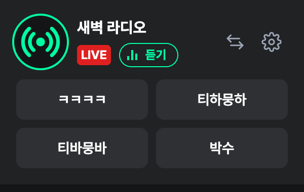
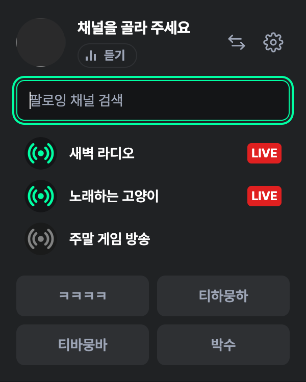
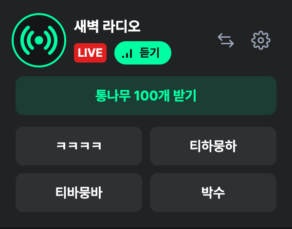
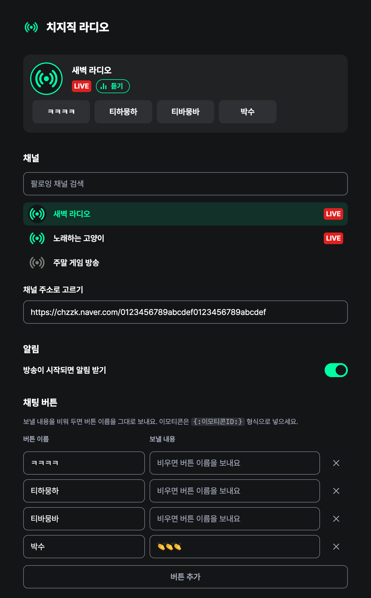

# 치지직 라디오 (비공식)

치지직 방송을 화면을 켜 두지 않고 듣고, 버튼 한 번으로 채팅을 보내는 크롬 확장 프로그램입니다.

> [!IMPORTANT]
> 치지직·네이버와 관련이 없는 **비공식** 도구입니다. 치지직 웹사이트가 내부적으로 쓰는 API를 사용하므로 치지직이 바뀌면 동작하지 않을 수 있습니다. 아래 [알아 둘 점](#알아-둘-점)을 먼저 읽어 주세요.

## 할 수 있는 것

- 고른 방송인이 방송 중인지 툴바 아이콘으로 확인합니다. 방송 중이면 컬러, 아니면 흑백입니다.
- 방송을 소리만 듣습니다. 치지직의 라디오 모드를 자동으로 켜고, 광고 스킵 버튼이 나오면 대신 누릅니다.
- 미리 정해 둔 채팅(`ㅋㅋㅋㅋ`, `티하뭉하` 등)을 버튼 한 번으로 보냅니다. 이모티콘도 보낼 수 있습니다.
- 받을 수 있는 통나무 파워가 있으면 버튼으로 받습니다.
- 방송이 시작되면 알림을 띄웁니다.

## 설치

크롬 웹 스토어에는 아직 등록하지 않아서, 파일을 내려받아 직접 설치합니다.

1. [Releases](https://github.com/GyuPin-Moon/chzzk-radio/releases/latest)에서 `chzzk-radio-v*.zip`을 내려받아 압축을 풉니다.
   - 압축을 푼 폴더는 지우거나 옮기지 말고 그 자리에 두세요. 크롬이 이 폴더에서 확장 프로그램을 읽습니다. 폴더를 옮기면 설정이 초기화됩니다.
2. 크롬 주소창에 `chrome://extensions`를 입력합니다.
3. 오른쪽 위 **개발자 모드**를 켭니다.
4. **압축해제된 확장 프로그램을 로드합니다**를 누르고, 1번에서 압축을 푼 폴더(`manifest.json`이 들어 있는 폴더)를 고릅니다.
5. 툴바의 퍼즐 모양 아이콘을 누르고 **치지직 라디오** 옆의 핀을 눌러 고정합니다.

Edge 같은 다른 크로미움 브라우저도 같은 방법(`edge://extensions`)으로 설치할 수 있지만, 크롬 외의 브라우저에서는 충분히 확인하지 않았습니다.

## 처음 연결하기

### 1. 치지직에 로그인

같은 브라우저에서 [chzzk.naver.com](https://chzzk.naver.com)에 네이버 계정으로 로그인해 둡니다. 확장 프로그램은 브라우저에 이미 로그인된 상태를 그대로 쓰고, 계정 정보를 따로 입력받지 않습니다.

로그인이 안 되어 있으면 팝업에 **네이버에 로그인** 버튼이 나옵니다.

### 2. 채널 고르기

툴바의 치지직 라디오 아이콘을 누르면 팝업이 열립니다. 처음에는 팔로우한 채널 목록이 바로 펼쳐지니, 들을 채널을 누르면 됩니다.

- 방송 중인 채널이 위쪽에 나옵니다. 검색창에 이름을 입력해 찾을 수도 있습니다.
- 나중에 채널을 바꾸려면 팝업 오른쪽 위의 ⇄ 버튼을 누릅니다.
- 팔로우하지 않은 채널은 ⚙ 설정에서 방송인 페이지 주소(`https://chzzk.naver.com/…`)를 붙여 넣으면 됩니다.

### 3. 듣기와 채팅

- **듣기**를 누르면 방송 페이지가 고정 탭으로 열립니다.
  - 크롬은 한 번도 화면에 보인 적 없는 탭에서는 재생을 시작하지 않기 때문에, 탭이 몇 초 동안 앞으로 나왔다가 원래 보던 탭으로 돌아갑니다.
  - 광고가 나오면 스킵 버튼이 생기는 대로 대신 누르고, 본방송이 시작되면 라디오 모드(소리만 받기)를 켭니다.
  - 듣는 중에는 버튼의 막대가 움직입니다. 다시 누르거나 고정 탭을 닫으면 꺼지고, 방송이 끝나도 1분 안에 자동으로 꺼집니다.
- **채팅 버튼**을 누르면 그 내용이 내 계정으로 채팅방에 올라갑니다. 연달아 보내지 않도록 한 번 보낸 뒤 3초 동안은 눌리지 않습니다.
- **통나무 받기**는 받을 수 있는 통나무가 있을 때만 나옵니다.

### 4. 설정

팝업의 ⚙ 버튼을 누르면 설정 페이지가 열립니다.

- **채널**: 팔로잉 목록에서 고르거나 주소를 직접 넣습니다.
- **알림**: 방송이 시작될 때 데스크톱 알림을 받을지 정합니다.
- **채팅 버튼**: 버튼 이름과 보낼 내용을 정합니다. 보낼 내용을 비워 두면 버튼 이름을 그대로 보냅니다. 바꾸는 즉시 저장되고, 지운 버튼은 몇 초 동안 **되돌리기**로 살릴 수 있습니다.

#### 이모티콘 보내기

보낼 내용에 `{:이모티콘ID:}` 형식으로 넣으면 이모티콘으로 보내집니다. 그 채널에서 쓸 수 있는 이모티콘만 보낼 수 있습니다(구독 이모티콘은 구독 중일 때만).

이모티콘 ID는 치지직 웹 채팅에서 확인합니다. 채팅창의 이모티콘 목록에서 원하는 이모티콘에 마우스 오른쪽 버튼을 누르고 **검사**를 고르면, 이미지의 `alt` 값이 `{:d_33:}`처럼 보입니다. 이 값을 그대로 붙여 넣으면 됩니다.

## 업데이트

새 버전의 zip을 내려받아, 처음 설치한 폴더에 압축을 풀어 덮어씁니다. 그다음 `chrome://extensions`에서 치지직 라디오의 새로고침(↻) 버튼을 누릅니다. 같은 폴더를 쓰면 설정이 그대로 남습니다.

## 알아 둘 점

- **비공식 API**: 치지직이 공개하지 않은 내부 API를 사용합니다. 치지직이 구조를 바꾸면 일부 기능이 예고 없이 멈출 수 있습니다.
- **약관**: 채팅 자동 전송과 광고 스킵 대신 누르기는 치지직 약관상 문제가 될 여지가 있습니다. 계정에 불이익이 생길 가능성이 크지 않지만 없다고 할 수는 없으니, 사용 여부는 직접 판단해 주세요.
- **개인 정보**: 네이버 로그인 쿠키를 읽거나 저장하지 않습니다. 브라우저가 치지직·네이버 주소로 요청을 보낼 때 자동으로 붙이는 로그인 상태를 쓸 뿐입니다. 이 확장 프로그램이 저장하는 것은 고른 채널, 채팅 버튼 목록, 알림 설정뿐이고, 네이버 외의 서버로는 아무것도 보내지 않습니다.

### 요청하는 권한

| 권한 | 쓰는 곳 |
| --- | --- |
| `storage` | 고른 채널, 채팅 버튼, 알림 설정 저장 |
| `alarms` | 1분마다 방송 상태 확인 |
| `notifications` | 방송 시작 알림 |
| `scripting` | 듣기로 연 방송 탭에서 광고 스킵 버튼과 라디오 모드 스위치 누르기 |
| `declarativeNetRequestWithHostAccess` | 치지직 API가 확장 프로그램에서 온 요청을 거부하지 않도록, 이 확장이 보내는 요청의 `Origin` 헤더만 `https://chzzk.naver.com`으로 바꾸기 |
| `chzzk.naver.com`, `api.chzzk.naver.com`, `comm-api.game.naver.com`, `*.chat.naver.com` | 방송 상태, 팔로잉 목록, 통나무, 채팅 |
| `nng-phinf.pstatic.net` | 방송인 프로필 이미지 |

## 문제가 생기면

[Issues](https://github.com/GyuPin-Moon/chzzk-radio/issues)에 남겨 주세요. 팝업에 뜬 오류 문구를 그대로 적어 주시면 원인을 찾기 쉽습니다. 보안 문제는 공개 이슈 대신 [SECURITY.md](SECURITY.md)의 방법으로 알려 주세요.

> [!WARNING]
> 개발자 도구의 네트워크·쿠키 화면은 올리지 마세요. `NID_AUT`, `NID_SES` 같은 값이 보이면 그것만으로 네이버 계정에 로그인할 수 있습니다.

## 라이선스

[MIT](LICENSE)
